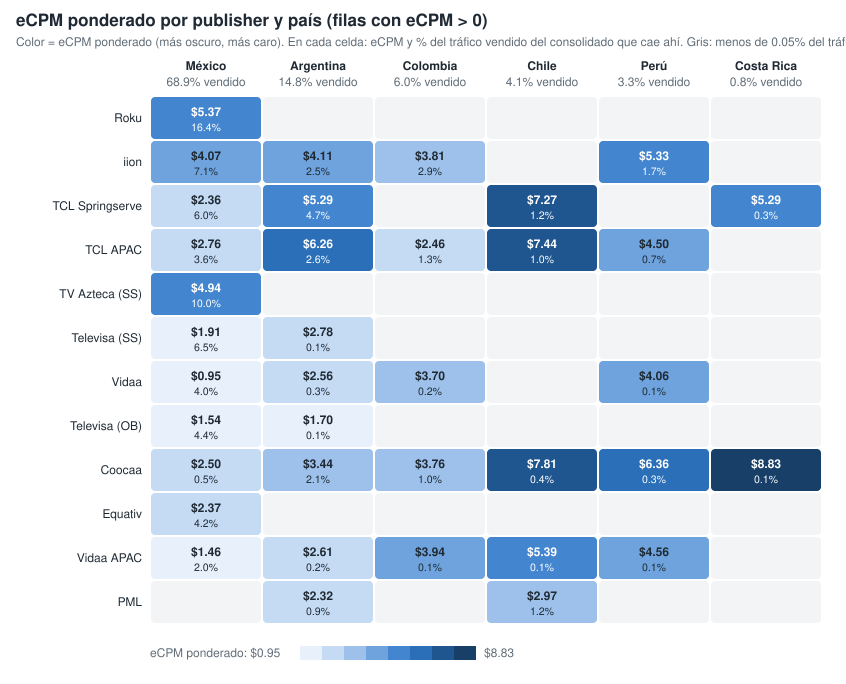
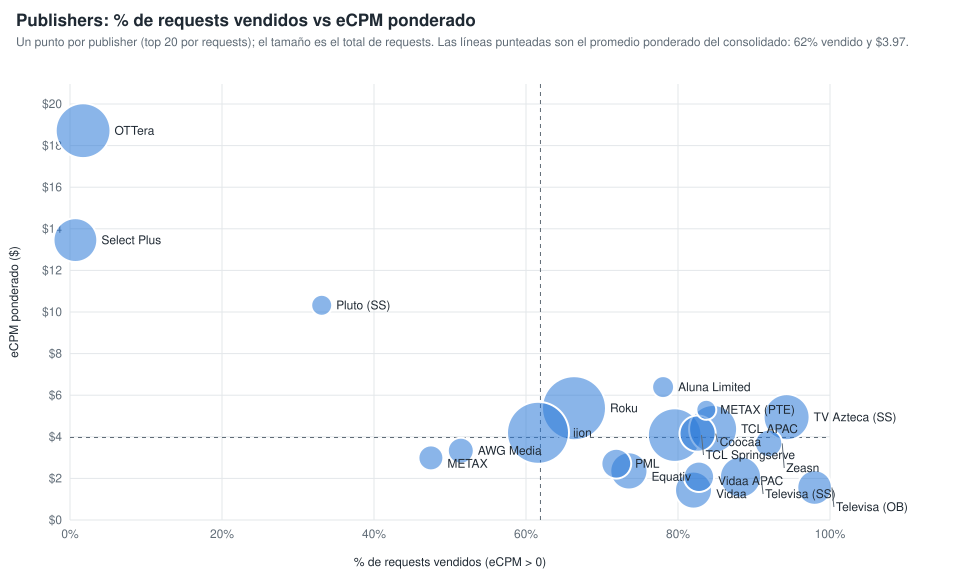

# Qué mueve el eCPM ponderado: la ruta de venta (publisher y país) (consolidado v10 a v25)

Sobre las filas con eCPM > 0 y requests > 0, la combinación publisher × país explica el 52.7 % de la variación del eCPM ponderado; los content objects, controlando por la ruta, aportan pocos puntos (género y rating los que más). Generado con `scripts/generar_graficos_drivers_ecpm.py` → `graficos-drivers-ecpm.json`.

## 1. eCPM ponderado por publisher y país

*Publishers ordenados por requests vendidos (top 12). En cada celda, eCPM ponderado y, debajo, % del tráfico vendido del consolidado que cae en esa combinación. Vacío = menos del 0.05 % del tráfico vendido.*

| Publisher | Mexico | Argentina | Colombia | Chile | Peru | Costa Rica |
|---|---:|---:|---:|---:|---:|---:|
| Roku - oRTB | $5.37 (16.4%) | — | — | — | — | — |
| iion Pty Ltd | $4.07 (7.1%) | $4.11 (2.5%) | $3.81 (2.9%) | — | $5.33 (1.7%) | — |
| TCL ADS - Springserve | $2.36 (6.0%) | $5.29 (4.7%) | — | $7.27 (1.2%) | — | $5.29 (0.3%) |
| TCL ADs (APAC) | $2.76 (3.6%) | $6.26 (2.6%) | $2.46 (1.3%) | $7.44 (1.0%) | $4.50 (0.7%) | — |
| TV Azteca - Springserve | $4.94 (10.0%) | — | — | — | — | — |
| Televisa Univision via SpringServe | $1.91 (6.5%) | $2.78 (0.1%) | — | — | — | — |
| Vidaa | $0.95 (4.0%) | $2.56 (0.3%) | $3.70 (0.1%) | — | $4.06 (0.1%) | — |
| Televisa Univision via OB | $1.54 (4.4%) | $1.70 (0.1%) | — | — | — | — |
| Coocaa, a SKYWORTH company | $2.50 (0.5%) | $3.44 (2.1%) | $3.76 (0.9%) | $7.81 (0.4%) | $6.36 (0.3%) | $8.83 (0.1%) |
| Equativ (Formerly SMART AdServer) - oRTB CTV | $2.37 (4.2%) | — | — | — | — | — |
| Vidaa  APAC Hisense Headquarter | $1.46 (2.0%) | $2.61 (0.2%) | $3.94 (0.1%) | $5.39 (0.1%) | $4.56 (0.1%) | — |
| PML Digital | — | $2.32 (0.9%) | — | $2.97 (1.2%) | — | — |

## 2. Publishers: % de requests vendidos vs eCPM ponderado

*Un punto por publisher (top 20 por requests); el tamaño es el total de requests. Líneas punteadas: promedio ponderado del consolidado (62 % vendido, $3.97).*

| Publisher | Requests | % vendido (eCPM > 0) | eCPM pond. | % del tráfico vendido |
|---|---:|---:|---:|---:|
| Roku - oRTB | 83,178,336,253 | 66.3% | $5.37 | 16.4% |
| iion Pty Ltd | 77,178,173,955 | 61.6% | $4.19 | 14.2% |
| OTTera.tv | 56,391,487,280 | 1.7% | $18.72 | 0.3% |
| TCL ADS - Springserve | 53,222,069,710 | 79.6% | $4.08 | 12.6% |
| TCL ADs (APAC) | 40,038,632,720 | 84.6% | $4.37 | 10.1% |
| TV Azteca - Springserve | 35,529,884,760 | 94.3% | $4.94 | 10.0% |
| Select Plus PTE LTD (CTV) | 31,277,242,240 | 0.7% | $13.46 | 0.1% |
| Televisa Univision via SpringServe | 26,173,898,000 | 88.2% | $2.06 | 6.9% |
| Equativ (Formerly SMART AdServer) - oRTB CTV | 19,438,387,280 | 73.5% | $2.36 | 4.3% |
| Vidaa | 19,313,510,960 | 82.0% | $1.44 | 4.7% |
| Coocaa, a SKYWORTH company | 18,128,176,800 | 82.6% | $4.15 | 4.5% |
| Televisa Univision via OB | 15,662,720,000 | 98.0% | $1.56 | 4.6% |
| Vidaa  APAC Hisense Headquarter | 10,340,557,360 | 82.7% | $2.08 | 2.5% |
| PML Digital | 9,658,939,840 | 71.9% | $2.71 | 2.1% |
| Zeasn Europe B.V. | 7,251,097,920 | 91.9% | $3.68 | 2.0% |
| AWG Media | 6,030,316,720 | 51.4% | $3.33 | 0.9% |
| METAX SOFTWARE PTE. LTD. (Exchange) | 5,209,762,080 | 47.5% | $2.99 | 0.7% |
| Aluna Limited | 3,073,146,000 | 78.0% | $6.39 | 0.7% |
| Pluto LATAM via SpringServe | 2,527,653,120 | 33.1% | $10.32 | 0.2% |
| METAX SOFTWARE PTE. LTD. | 1,963,928,880 | 83.7% | $5.30 | 0.5% |
