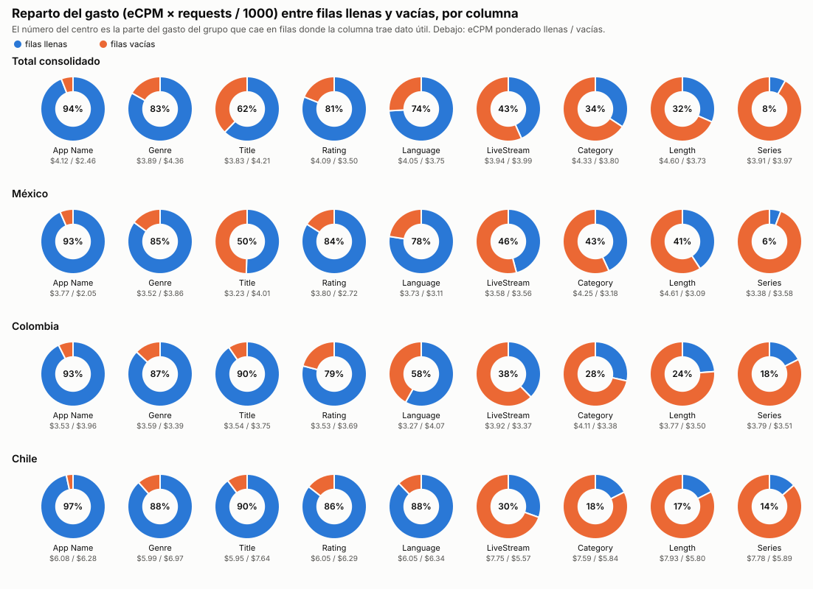
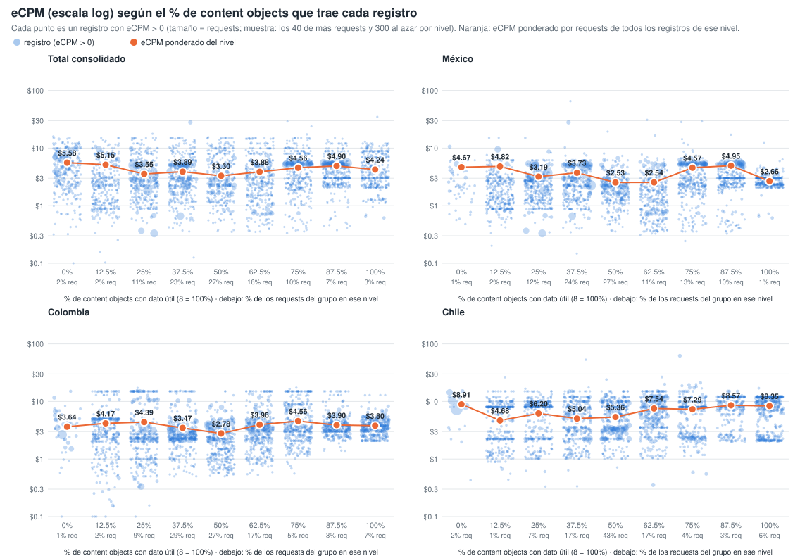
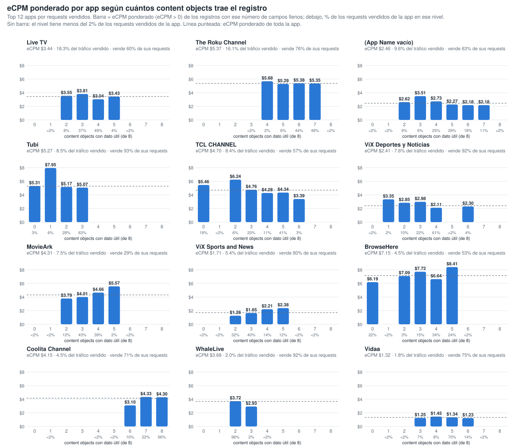
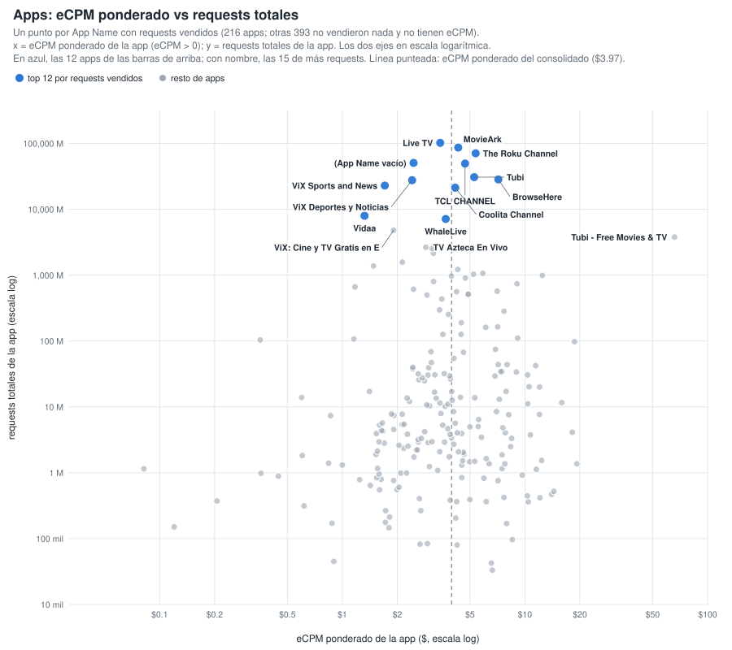
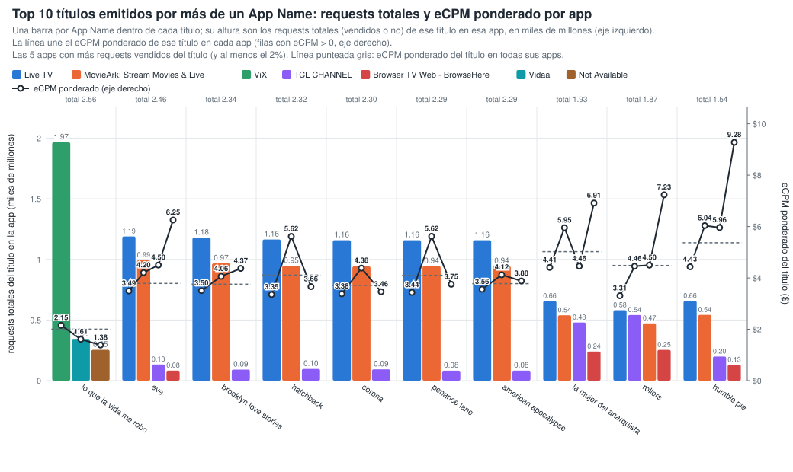
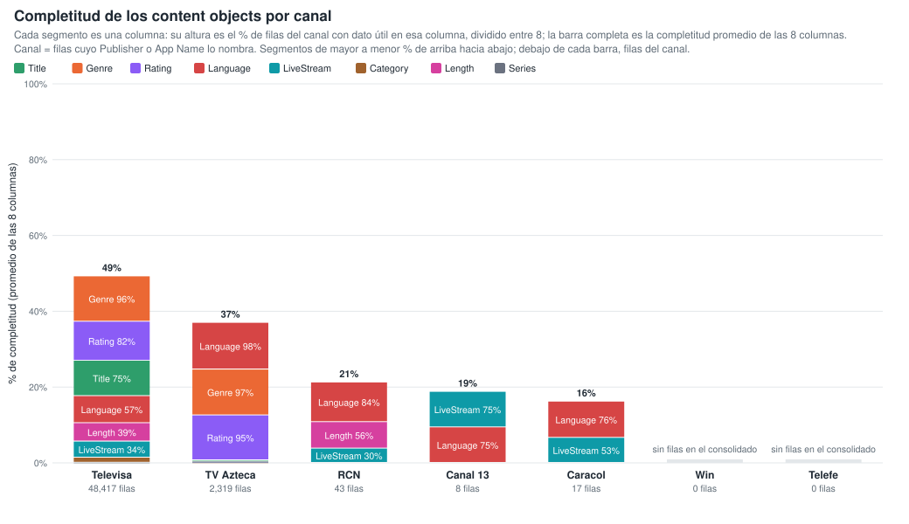
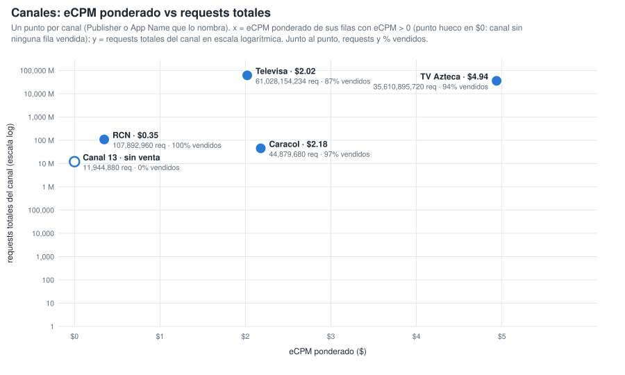
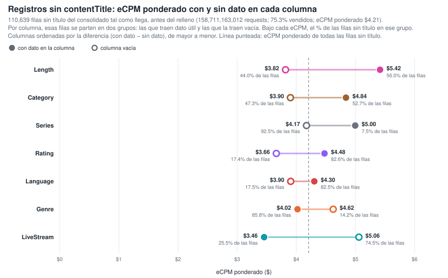
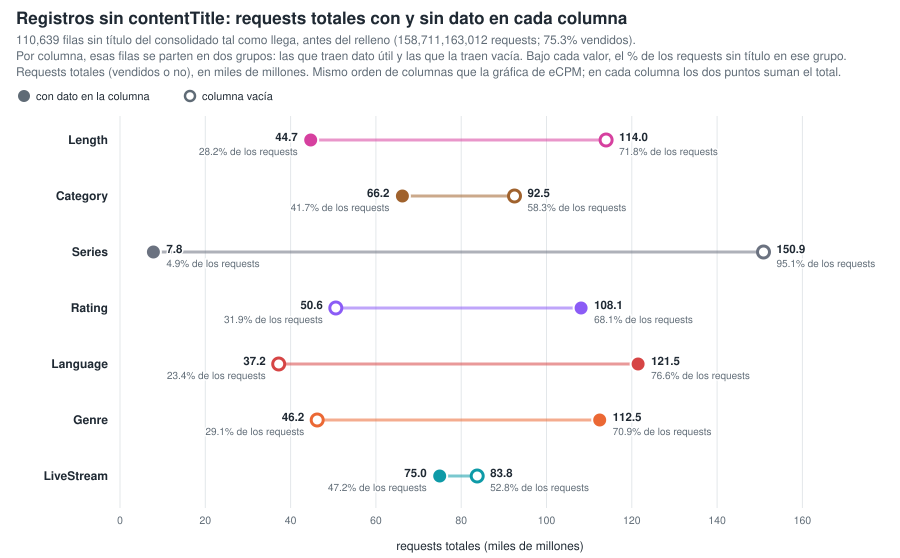
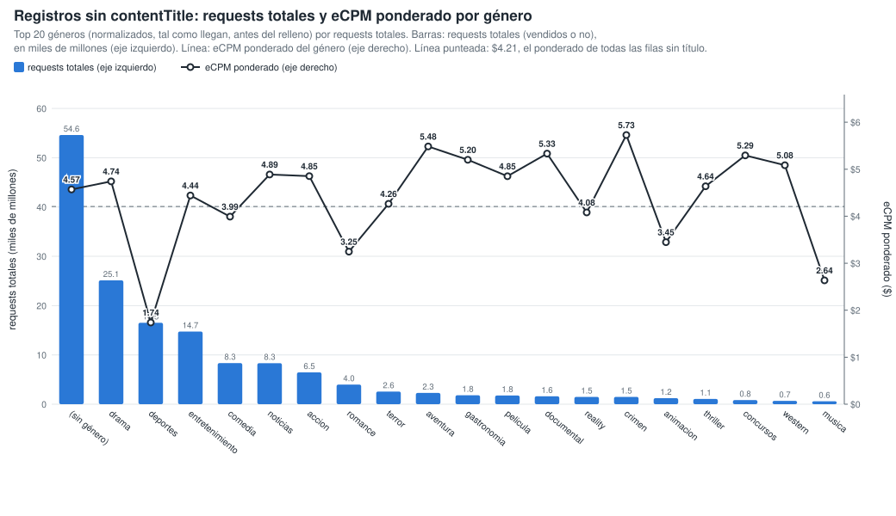

# Gráficos: eCPM de las filas llenas vs vacías (consolidado v10 a v25)

**Fuente:** `recursos/reporte-requests-ecpm-por-vacio-v25.json` (mismos datos de las tablas por país del detallado). Generado con `scripts/generar_graficos_ecpm_vacio.py` → `recursos/graficos-ecpm-vacio-r2.json`; tablas con `scripts/generar_reporte_graficos.py`.

*eCPM ponderado = Σ(eCPM × requests) / Σ requests, sin las filas con requests = 0 o eCPM = 0. Columnas: App Name y los 8 content objects con filas vacías; contentIsTitlePresent y Publisher vienen al 100% y no entran.*

## 1. Reparto del gasto (eCPM × requests / 1000) entre filas llenas y vacías

*% del gasto del grupo que cae en filas donde la columna trae dato útil. El gasto se calcula solo sobre filas con eCPM > 0.*

| Columna | Total consolidado | México | Colombia | Chile |
|---|---:|---:|---:|---:|
| App Name | 94.1% | 93.4% | 92.6% | 96.6% |
| contentGenre | 83.2% | 85.1% | 87.1% | 88.4% |
| contentTitle | 62.2% | 50.4% | 90.5% | 89.8% |
| contentRating | 81.1% | 84.0% | 79.1% | 85.6% |
| contentLanguage | 74.1% | 77.5% | 58.1% | 87.8% |
| contentIsLiveStream | 43.3% | 45.9% | 37.7% | 30.4% |
| contentCategory | 34.3% | 43.1% | 28.5% | 17.6% |
| contentLength | 31.6% | 40.8% | 23.8% | 17.4% |
| contentSeries | 8.1% | 5.7% | 17.6% | 13.6% |

## 2. % de columnas llenas de la fila vs eCPM (fila a fila)

Cada registro del consolidado se clasifica por el % de los 8 content objects que trae con dato útil (contentGenre, contentCategory, contentSeries, contentLength, contentLanguage, contentIsLiveStream, contentTitle, contentRating; contentIsTitlePresent no cuenta porque siempre viene). Cada punto es un registro con eCPM > 0, con el eCPM en escala logarítmica y el tamaño según sus requests (por nivel y panel se dibujan los 40 registros de más requests y 300 al azar). El punto naranja es el eCPM ponderado por requests de todos los registros del nivel. Generado con `scripts/generar_scatter_completitud_ecpm.py` → `recursos/graficos-ecpm-completitud-scatter.json`.

**Total consolidado** — 1,443,390 filas · 541,945,571,178 requests

| % de columnas llenas (de 8) | % filas | % requests | % requests vendidos (eCPM > 0) | eCPM pond. (>0) |
|---:|---:|---:|---:|---:|
| 0% (0) | 0.1% | 2.1% | 90.9% | $5.58 |
| 12.5% (1) | 1.9% | 1.8% | 54.3% | $5.15 |
| 25% (2) | 10.5% | 10.6% | 66.3% | $3.55 |
| 37.5% (3) | 23.4% | 22.6% | 67.3% | $3.90 |
| 50% (4) | 31.8% | 27.4% | 53.8% | $3.30 |
| 62.5% (5) | 21.6% | 15.6% | 46.8% | $3.88 |
| 75% (6) | 5.7% | 9.6% | 69.1% | $4.56 |
| 87.5% (7) | 2.5% | 7.3% | 81.9% | $4.91 |
| 100% (8) | 2.5% | 2.8% | 70.8% | $4.24 |

**México** — 430,242 filas · 329,805,756,481 requests

| % de columnas llenas (de 8) | % filas | % requests | % requests vendidos (eCPM > 0) | eCPM pond. (>0) |
|---:|---:|---:|---:|---:|
| 0% (0) | 0.1% | 0.7% | 84.4% | $4.67 |
| 12.5% (1) | 2.8% | 1.9% | 57.7% | $4.82 |
| 25% (2) | 13.2% | 12.1% | 77.1% | $3.19 |
| 37.5% (3) | 22.2% | 24.0% | 77.8% | $3.73 |
| 50% (4) | 29.8% | 26.7% | 58.4% | $2.54 |
| 62.5% (5) | 18.0% | 11.2% | 53.9% | $2.54 |
| 75% (6) | 8.3% | 12.5% | 74.8% | $4.57 |
| 87.5% (7) | 4.1% | 10.1% | 87.1% | $4.95 |
| 100% (8) | 1.5% | 0.8% | 74.2% | $2.66 |

**Colombia** — 150,486 filas · 40,325,293,005 requests

| % de columnas llenas (de 8) | % filas | % requests | % requests vendidos (eCPM > 0) | eCPM pond. (>0) |
|---:|---:|---:|---:|---:|
| 0% (0) | 0.2% | 1.1% | 85.5% | $3.64 |
| 12.5% (1) | 2.3% | 1.9% | 40.0% | $4.17 |
| 25% (2) | 13.1% | 9.5% | 45.9% | $4.38 |
| 37.5% (3) | 31.3% | 28.9% | 55.3% | $3.47 |
| 50% (4) | 24.5% | 26.8% | 44.0% | $2.78 |
| 62.5% (5) | 19.1% | 17.2% | 33.2% | $3.96 |
| 75% (6) | 5.1% | 4.9% | 43.3% | $4.56 |
| 87.5% (7) | 1.9% | 3.0% | 76.2% | $3.90 |
| 100% (8) | 2.5% | 6.9% | 82.9% | $3.80 |

**Chile** — 158,556 filas · 31,589,839,853 requests

| % de columnas llenas (de 8) | % filas | % requests | % requests vendidos (eCPM > 0) | eCPM pond. (>0) |
|---:|---:|---:|---:|---:|
| 0% (0) | 0.1% | 1.7% | 82.3% | $8.91 |
| 12.5% (1) | 1.7% | 0.9% | 18.7% | $4.68 |
| 25% (2) | 14.2% | 7.3% | 24.3% | $6.20 |
| 37.5% (3) | 28.4% | 17.4% | 27.0% | $5.04 |
| 50% (4) | 34.1% | 42.6% | 57.2% | $5.36 |
| 62.5% (5) | 14.5% | 17.0% | 34.7% | $7.54 |
| 75% (6) | 3.6% | 4.2% | 28.1% | $7.29 |
| 87.5% (7) | 1.4% | 2.7% | 36.0% | $8.57 |
| 100% (8) | 2.1% | 6.2% | 44.8% | $8.35 |

## 3. Por app: eCPM ponderado según cuántos content objects trae el registro

Top 12 apps por requests vendidos. Para cada app, barra = eCPM ponderado (eCPM > 0) de los registros con ese número de content objects con dato útil (de 8); debajo de cada barra, el % de los requests vendidos de la app en ese nivel. Los niveles con menos del 2 % de los requests vendidos de la app no se dibujan ni se tabulan. Generado con `scripts/generar_barras_app_completitud.py` → `recursos/graficos-app-completitud-barras.json`.

| App | eCPM pond. app | % tráfico vendido | 0 | 1 | 2 | 3 | 4 | 5 | 6 | 7 | 8 |
|---|---:|---:|---:|---:|---:|---:|---:|---:|---:|---:|---:|
| Live TV | $3.44 | 18.3% | — | — | $3.55 (8%) | $3.81 (37%) | $3.04 (49%) | $3.43 (4%) | — | — | — |
| The Roku Channel | $5.37 | 16.1% | — | — | — | — | $5.68 (2%) | $5.29 (6%) | $5.38 (44%) | $5.35 (48%) | — |
| Not Available | $2.46 | 9.6% | — | — | $2.62 (9%) | $3.51 (6%) | $2.73 (25%) | $2.27 (29%) | $2.18 (18%) | $2.18 (11%) | — |
| Tubi: Free Movies & Live TV | $5.27 | 8.5% | $5.31 (3%) | $7.95 (6%) | $5.17 (28%) | $5.07 (63%) | — | — | — | — | — |
| TCL CHANNEL | $4.70 | 8.4% | $5.46 (18%) | — | $6.24 (6%) | $4.76 (20%) | $4.28 (11%) | $4.34 (41%) | $3.39 (3%) | — | — |
| ViX: TV, Deportes y Noticias | $2.41 | 7.6% | — | $3.35 (2%) | $2.85 (10%) | $2.98 (22%) | $2.11 (61%) | — | $2.30 (4%) | — | — |
| MovieArk: Stream Movies & Live | $4.31 | 7.5% | — | — | $3.79 (12%) | $4.01 (43%) | $4.66 (39%) | $5.57 (2%) | — | — | — |
| ViX: TV, Sports and News | $1.71 | 5.4% | — | — | $1.26 (32%) | $1.65 (40%) | $2.21 (14%) | $2.38 (12%) | — | — | — |
| Browser TV Web - BrowseHere | $7.15 | 4.5% | $6.19 (22%) | — | $7.09 (3%) | $7.72 (15%) | $6.64 (34%) | $8.41 (24%) | — | — | — |
| Coolita Channel | $4.15 | 4.5% | — | — | — | — | — | — | $3.10 (10%) | $4.33 (22%) | $4.30 (66%) |
| WhaleLive | $3.68 | 2.0% | — | — | $3.72 (96%) | $2.93 (2%) | — | — | — | — | — |
| Vidaa | $1.32 | 1.8% | — | — | — | $1.25 (7%) | $1.45 (8%) | $1.34 (70%) | $1.23 (14%) | — | — |

*Entre paréntesis, el % de los requests vendidos de la app que cae en ese nivel de campos llenos.*

### 3.1 Apps: eCPM ponderado vs requests totales

Un punto por App Name con requests vendidos (216 apps; otras 393 no vendieron nada y no tienen eCPM). x = eCPM ponderado de la app (eCPM > 0); y = requests totales de la app; los dos ejes en escala logarítmica. Línea punteada: eCPM ponderado del consolidado ($3.97). Tabla: las 30 apps de más requests; todas están en `recursos/graficos-app-requests-ecpm.json`.

| App | Requests | Requests vendidos | % vendido | eCPM pond. |
|---|---:|---:|---:|---:|
| Live TV | 102,210,817,894 | 61,438,034,140 | 60.1% | $3.44 |
| MovieArk: Stream Movies & Live | 86,699,228,968 | 25,062,791,888 | 28.9% | $4.31 |
| The Roku Channel | 70,795,845,488 | 53,950,723,268 | 76.2% | $5.37 |
| Not Available | 50,604,962,126 | 32,097,296,829 | 63.4% | $2.46 |
| TCL CHANNEL | 49,539,847,900 | 28,300,175,526 | 57.1% | $4.70 |
| Tubi: Free Movies & Live TV | 30,799,116,864 | 28,597,336,932 | 92.9% | $5.27 |
| Browser TV Web - BrowseHere | 28,457,748,250 | 15,144,108,173 | 53.2% | $7.15 |
| ViX: TV, Deportes y Noticias | 27,616,133,928 | 25,400,573,082 | 92.0% | $2.41 |
| ViX: TV, Sports and News | 22,947,956,828 | 18,234,335,280 | 79.5% | $1.71 |
| Coolita Channel | 21,279,378,458 | 15,056,357,600 | 70.8% | $4.15 |
| Vidaa | 7,974,198,723 | 5,973,368,640 | 74.9% | $1.32 |
| WhaleLive | 7,129,237,920 | 6,562,935,840 | 92.1% | $3.68 |
| ViX: Cine y TV Gratis en Español | 4,825,420,916 | 4,057,247,360 | 84.1% | $1.91 |
| Tubi - Free Movies & TV | 3,781,371,964 | 56,320 | 0.0% | $65.89 |
| TV Azteca En Vivo | 2,654,098,376 | 2,603,355,026 | 98.1% | $2.87 |
| Azteca TV | 2,533,248,720 | 2,498,985,680 | 98.6% | $3.10 |
| SAMSUNG TV PLUS | 2,150,796,450 | 1,341,599,167 | 62.4% | $3.16 |
| VIX - Filmes e TV | 1,575,222,480 | 1,476,872,160 | 93.8% | $2.13 |
| ViX: Cine y TV en Español | 1,382,455,728 | 1,232,607,520 | 89.2% | $1.48 |
| Open Browser - TV Web Browser | 1,220,540,960 | 1,072,539,520 | 87.9% | $4.29 |
| Metax TV - Live TV & Movies | 1,065,026,720 | 763,467,680 | 71.7% | $5.88 |
| Ottera | 1,029,552,579 | 524,337,707 | 50.9% | $5.23 |
| PlutoTV: Stream Free Movies/TV | 990,326,480 | 397,556,080 | 40.1% | $12.46 |
| Plex: Find Movies & TV Shows | 967,308,161 | 146,111,439 | 15.1% | $3.96 |
| Plex - Free Movies & TV | 905,014,500 | 200,339,368 | 22.1% | $4.71 |
| FreeTV: Películas, Series y TV | 801,056,606 | 360,906,720 | 45.1% | $3.16 |
| Pluto TV: Watch Free Movies/TV | 740,391,018 | 187,276,800 | 25.3% | $9.04 |
| Univision App: Univision & Unimas Free | 663,161,261 | 642,590,719 | 96.9% | $1.17 |
| FreeTube- Search & Watch Free | 611,608,870 | 174,041,960 | 28.5% | $2.45 |
| Pluto TV - Free Movies/Shows | 571,529,760 | 118,320,000 | 20.7% | $7.04 |

## 4. Títulos emitidos por más de un App Name

20,252 títulos reales, agrupados solo por App Name (sin pageURL). Generado con `scripts/generar_tabla_pageurl_titulos.py` → `recursos/titulos-appname.json`.

| App Name distintos por título | % de títulos | % de requests |
|---:|---:|---:|
| 1 | 51.6% | 7.7% |
| 2 | 25.3% | 9.4% |
| 3 | 9.0% | 11.8% |
| 4 | 3.8% | 2.1% |
| 5+ | 10.4% | 69.1% |

**Top 10 títulos (por requests) en dos o más App Name:** una barra por App Name dentro de cada título, con altura = requests totales (vendidos o no) de ese título en esa app, en miles de millones, en el eje izquierdo (las 5 apps con más requests vendidos del título, de mayor a menor requests). La línea une el eCPM ponderado (eCPM > 0) de ese título en cada app, en el eje derecho. Línea punteada = eCPM ponderado del título en todas sus apps; sobre cada grupo, los requests totales del título. Las variantes de ViX (ViX: TV, Deportes y Noticias; ViX: TV, Sports and News; ViX: Cine y TV…; VIX - Filmes e TV) cuentan como una sola app, ViX.

| Título | App Name | Requests | eCPM pond. | Reparto por app (% de requests vendidos, eCPM pond. de la app) |
|---|---:|---:|---:|---|
| lo que la vida me robo | 3 | 2,563,364,446 | $2.00 | ViX 77% ($2.15), Vidaa 13% ($1.61), Not Available 10% ($1.38) |
| eve | 10 | 2,464,652,620 | $3.79 | Live TV 62% ($3.49), MovieArk: Stream Movies & Live 28% ($4.20), TCL CHANNEL 6% ($4.50), Browser TV Web - BrowseHere 2% ($6.25), ViX 1% ($2.05) |
| brooklyn love stories | 9 | 2,344,513,311 | $3.76 | Live TV 67% ($3.50), MovieArk: Stream Movies & Live 28% ($4.06), TCL CHANNEL 2% ($4.37), Browser TV Web - BrowseHere 2% ($7.77), Not Available 0% ($3.85) |
| hatchback | 8 | 2,316,124,031 | $4.11 | Live TV 65% ($3.35), MovieArk: Stream Movies & Live 30% ($5.62), TCL CHANNEL 3% ($3.66), Browser TV Web - BrowseHere 2% ($7.04), Not Available 0% ($4.14) |
| corona | 9 | 2,303,753,315 | $3.71 | Live TV 67% ($3.38), MovieArk: Stream Movies & Live 28% ($4.38), TCL CHANNEL 3% ($3.46), Browser TV Web - BrowseHere 2% ($6.28), Not Available 0% ($3.91) |
| penance lane | 9 | 2,288,998,388 | $4.10 | Live TV 67% ($3.44), MovieArk: Stream Movies & Live 29% ($5.62), TCL CHANNEL 2% ($3.75), Browser TV Web - BrowseHere 1% ($5.94), Not Available 0% ($3.77) |
| american apocalypse | 9 | 2,285,969,091 | $3.77 | Live TV 67% ($3.56), MovieArk: Stream Movies & Live 28% ($4.12), TCL CHANNEL 3% ($3.88), Browser TV Web - BrowseHere 2% ($6.50), Not Available 0% ($5.06) |
| la mujer del anarquista | 8 | 1,930,861,786 | $5.02 | Live TV 39% ($4.41), TCL CHANNEL 31% ($4.46), MovieArk: Stream Movies & Live 16% ($5.95), Browser TV Web - BrowseHere 14% ($6.91), Not Available 0% ($6.38) |
| rollers | 7 | 1,866,445,561 | $4.48 | Live TV 35% ($3.31), TCL CHANNEL 33% ($4.46), Browser TV Web - BrowseHere 16% ($7.23), MovieArk: Stream Movies & Live 15% ($4.50), Not Available 0% ($2.86) |
| humble pie | 7 | 1,543,491,241 | $5.37 | Live TV 56% ($4.43), MovieArk: Stream Movies & Live 23% ($6.04), TCL CHANNEL 12% ($5.96), Browser TV Web - BrowseHere 8% ($9.28), Not Available 0% ($7.03) |

| Título | Requests del título | Requests por app (% de los requests del título) |
|---|---:|---|
| lo que la vida me robo | 2,563,364,446 | ViX 1,965,145,006 (77%), Vidaa 343,949,600 (13%), Not Available 254,269,840 (10%) |
| eve | 2,464,652,620 | Live TV 1,189,080,901 (48%), MovieArk: Stream Movies & Live 993,045,968 (40%), TCL CHANNEL 132,902,220 (5%), Browser TV Web - BrowseHere 83,147,605 (3%) |
| brooklyn love stories | 2,344,513,311 | Live TV 1,178,230,156 (50%), MovieArk: Stream Movies & Live 966,724,266 (41%), TCL CHANNEL 90,750,447 (4%) |
| hatchback | 2,316,124,031 | Live TV 1,163,747,977 (50%), MovieArk: Stream Movies & Live 945,717,258 (41%), TCL CHANNEL 95,762,529 (4%) |
| corona | 2,303,753,315 | Live TV 1,157,791,557 (50%), MovieArk: Stream Movies & Live 942,196,592 (41%), TCL CHANNEL 92,701,104 (4%) |
| penance lane | 2,288,998,388 | Live TV 1,157,526,698 (51%), MovieArk: Stream Movies & Live 943,819,840 (41%), TCL CHANNEL 82,341,690 (4%) |
| american apocalypse | 2,285,969,091 | Live TV 1,157,537,216 (51%), MovieArk: Stream Movies & Live 943,540,412 (41%), TCL CHANNEL 82,653,111 (4%) |
| la mujer del anarquista | 1,930,861,786 | Live TV 656,315,133 (34%), MovieArk: Stream Movies & Live 538,901,468 (28%), TCL CHANNEL 479,086,506 (25%), Browser TV Web - BrowseHere 239,644,673 (12%) |
| rollers | 1,866,445,561 | Live TV 580,828,243 (31%), TCL CHANNEL 540,702,819 (29%), MovieArk: Stream Movies & Live 471,917,754 (25%), Browser TV Web - BrowseHere 253,440,207 (14%) |
| humble pie | 1,543,491,241 | Live TV 656,393,595 (43%), MovieArk: Stream Movies & Live 541,719,240 (35%), TCL CHANNEL 198,662,574 (13%), Browser TV Web - BrowseHere 129,791,444 (8%) |

## 5. Completitud de los content objects por canal

Canal = filas cuyo Publisher o App Name lo nombra (Caracol via OB / ditu por Caracol, RCN via OB / Canal RCN, Canal 13 OB, Televisa Univision via … / ViX, TV Azteca - Springserve / Azteca TV). Cada segmento de la barra es una columna, con altura = % de filas del canal con dato útil en esa columna dividido entre 8, apilados de mayor % (arriba) a menor (abajo); la barra completa es la completitud promedio de las 8 columnas. La tabla va ordenada por completitud promedio. Generado con `scripts/generar_barras_canales_completitud.py` → `recursos/graficos-canales-completitud-barras.json`.

| Canal | Promedio | Filas | Requests | Title | Genre | Rating | Language | IsLiveStream | Category | Length | Series |
|---|---:|---:|---:|---:|---:|---:|---:|---:|---:|---:|---:|
| Televisa | 49.2% | 48,417 | 61,028,154,234 | 74.6% | 95.7% | 82.5% | 57.2% | 34.0% | 10.7% | 38.8% | 0.3% |
| TV Azteca | 37.0% | 2,319 | 35,610,895,720 | 2.6% | 96.8% | 94.8% | 98.5% | 0.8% | 0.6% | 0.6% | 0.9% |
| RCN | 21.2% | 43 | 107,892,960 | 0.0% | 0.0% | 0.0% | 83.7% | 30.2% | 0.0% | 55.8% | 0.0% |
| Canal 13 | 18.8% | 8 | 11,944,880 | 0.0% | 0.0% | 0.0% | 75.0% | 75.0% | 0.0% | 0.0% | 0.0% |
| Caracol | 16.2% | 17 | 44,879,680 | 0.0% | 0.0% | 0.0% | 76.5% | 52.9% | 0.0% | 0.0% | 0.0% |
| Win | — | 0 | 0 | — | — | — | — | — | — | — | — |
| Telefe | — | 0 | 0 | — | — | — | — | — | — | — | — |

*Win y Telefe no aparecen en el consolidado: ningún Publisher ni App Name los nombra.*

## 6. Canales: eCPM ponderado vs requests totales

Un punto por canal (mismos canales y misma definición de la sección 5). x = eCPM ponderado de sus filas con eCPM > 0; un canal con requests pero sin ninguna fila vendida va en $0 con un punto hueco; y = requests totales del canal en escala logarítmica. Junto al punto, requests totales y % de requests vendidos.

| Canal | Requests | Requests vendidos | % vendido | eCPM pond. |
|---|---:|---:|---:|---:|
| Televisa | 61,028,154,234 | 53,011,418,202 | 86.9% | $2.02 |
| TV Azteca | 35,610,895,720 | 33,548,827,718 | 94.2% | $4.94 |
| RCN | 107,892,960 | 107,747,840 | 99.9% | $0.35 |
| Caracol | 44,879,680 | 43,602,560 | 97.2% | $2.18 |
| Canal 13 | 11,944,880 | 0 | 0.0% | — (sin filas vendidas) |
| Win | 0 | 0 | — | — |
| Telefe | 0 | 0 | — | — |

## 7. Registros sin contentTitle: qué content objects se relacionan con el eCPM

110,639 filas sin título (158,711,163,012 requests; 75.3% vendidos; eCPM ponderado $4.21). Generado con `scripts/generar_graficos_sin_titulo.py` → `recursos/graficos-sin-titulo.json`.

### 7.1 eCPM ponderado con y sin dato en cada columna

Filas sin título del consolidado tal como llega, antes del relleno. Por columna se parten en dos grupos: las que traen dato útil (círculo lleno) y las que la traen vacía (círculo hueco); de cada grupo, su % de las filas sin título, su % de requests vendidos y su eCPM ponderado. Diferencia = eCPM con dato − eCPM sin dato.

| Columna | % filas con dato | % vendido con dato | eCPM pond. con dato | % filas sin dato | % vendido sin dato | eCPM pond. sin dato | Diferencia |
|---|---:|---:|---:|---:|---:|---:|---:|
| contentLength | 56.0% | 65.1% | $5.42 | 44.0% | 79.3% | $3.82 | +$1.60 |
| contentCategory | 52.7% | 58.9% | $4.84 | 47.3% | 87.0% | $3.90 | +$0.94 |
| contentSeries | 7.5% | 65.7% | $5.00 | 92.5% | 75.8% | $4.17 | +$0.82 |
| contentRating | 82.6% | 74.0% | $4.48 | 17.4% | 78.0% | $3.66 | +$0.82 |
| contentLanguage | 82.5% | 74.5% | $4.30 | 17.5% | 77.7% | $3.90 | +$0.40 |
| contentGenre | 85.8% | 73.3% | $4.02 | 14.2% | 80.1% | $4.62 | −$0.60 |
| contentIsLiveStream | 25.5% | 84.7% | $3.46 | 74.5% | 66.9% | $5.06 | −$1.60 |

### 7.2 Requests totales con y sin dato en cada columna

Las mismas filas sin título y los mismos dos grupos por columna que en 7.1 (mismo orden de columnas), con los requests totales (vendidos o no) de cada grupo en el eje x, en miles de millones. En cada columna los dos puntos suman el total de requests sin título (158,711,163,012).

| Columna | Requests con dato | % requests con dato | Requests sin dato | % requests sin dato |
|---|---:|---:|---:|---:|
| contentLength | 44,719,086,143 | 28.2% | 113,992,076,869 | 71.8% |
| contentCategory | 66,216,991,797 | 41.7% | 92,494,171,215 | 58.3% |
| contentSeries | 7,827,658,973 | 4.9% | 150,883,504,039 | 95.1% |
| contentRating | 108,119,413,733 | 68.1% | 50,591,749,279 | 31.9% |
| contentLanguage | 121,495,133,130 | 76.6% | 37,216,029,882 | 23.4% |
| contentGenre | 112,475,338,879 | 70.9% | 46,235,824,133 | 29.1% |
| contentIsLiveStream | 74,954,809,377 | 47.2% | 83,756,353,635 | 52.8% |

### 7.3 Requests totales y eCPM ponderado por género en las filas sin título

Género normalizado tal como llega. Explica el 16.8 % de la variación del eCPM ponderado solo y aporta 5.0 puntos más controlando por publisher × país (rating: 9.4 % y 5.2 puntos; livestream, length, categoría y series: 8.2 puntos o menos).

Top 20 géneros por requests totales. Barras = requests totales (vendidos o no) del género, en miles de millones (eje izquierdo), de mayor a menor; línea = eCPM ponderado del género (eje derecho). Línea punteada = eCPM ponderado de todas las filas sin título.

| Género | Filas | Requests | % vendido | % del tráfico vendido sin título | eCPM pond. |
|---|---:|---:|---:|---:|---:|
| (sin género) | 38,287 | 54,613,331,013 | 72.4% | 33.1% | $4.57 |
| drama | 10,344 | 25,118,036,721 | 70.0% | 14.7% | $4.74 |
| deportes | 4,688 | 16,519,749,586 | 92.1% | 12.7% | $1.74 |
| entretenimiento | 5,156 | 14,739,374,725 | 81.2% | 10.0% | $4.44 |
| comedia | 7,178 | 8,345,232,999 | 75.1% | 5.2% | $3.99 |
| noticias | 3,359 | 8,319,197,876 | 86.2% | 6.0% | $4.89 |
| accion | 5,896 | 6,452,130,970 | 76.6% | 4.1% | $4.85 |
| romance | 3,093 | 3,970,198,844 | 82.2% | 2.7% | $3.25 |
| terror | 2,813 | 2,563,129,358 | 73.2% | 1.6% | $4.26 |
| aventura | 1,573 | 2,281,058,163 | 66.6% | 1.3% | $5.48 |
| gastronomia | 683 | 1,809,020,407 | 65.8% | 1.0% | $5.20 |
| pelicula | 2,519 | 1,761,010,472 | 77.1% | 1.1% | $4.85 |
| documental | 3,188 | 1,600,777,043 | 63.3% | 0.8% | $5.33 |
| reality | 3,557 | 1,483,927,770 | 69.4% | 0.9% | $4.08 |
| crimen | 4,331 | 1,479,243,327 | 57.0% | 0.7% | $5.73 |
| animacion | 466 | 1,225,508,224 | 65.2% | 0.7% | $3.45 |
| thriller | 2,440 | 1,067,231,010 | 71.4% | 0.6% | $4.64 |
| concursos | 746 | 835,554,221 | 78.4% | 0.5% | $5.29 |
| western | 602 | 685,887,482 | 76.8% | 0.4% | $5.08 |
| musica | 649 | 588,109,360 | 63.2% | 0.3% | $2.64 |
