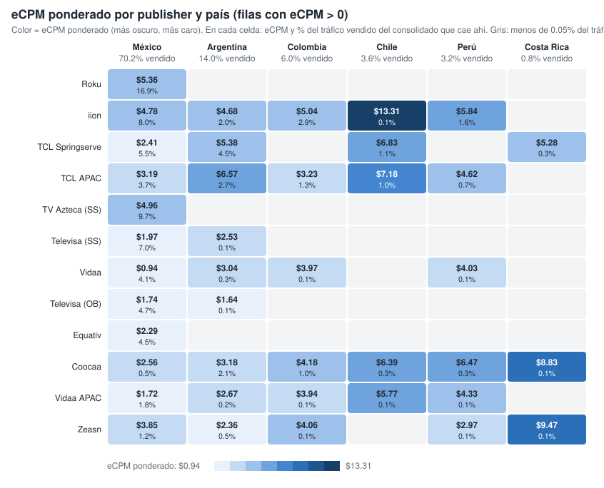
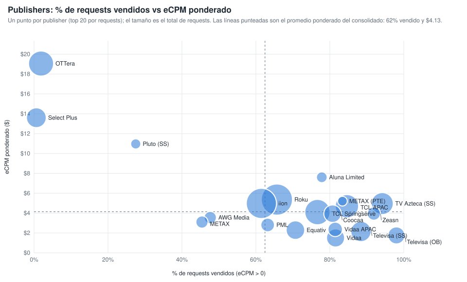

# Qué mueve el eCPM ponderado: la ruta de venta (publisher y país) (consolidado v10 a v26)

Sobre las filas con eCPM > 0 y requests > 0, la combinación publisher × país explica el 50.9 % de la variación del eCPM ponderado; los content objects, controlando por la ruta, aportan pocos puntos (género y rating los que más). Generado con `scripts/generar_graficos_drivers_ecpm.py` → `graficos-drivers-ecpm.json`.

## 1. eCPM ponderado por publisher y país

*Publishers ordenados por requests vendidos (top 12). En cada celda, eCPM ponderado y, debajo, % del tráfico vendido del consolidado que cae en esa combinación. Vacío = menos del 0.05 % del tráfico vendido.*

| Publisher | Mexico | Argentina | Colombia | Chile | Peru | Costa Rica |
|---|---:|---:|---:|---:|---:|---:|
| Roku - oRTB | $5.36 (16.9%) | — | — | — | — | — |
| iion Pty Ltd | $4.78 (8.0%) | $4.67 (2.0%) | $5.04 (2.9%) | $13.31 (0.1%) | $5.84 (1.6%) | — |
| TCL ADS - Springserve | $2.41 (5.5%) | $5.38 (4.5%) | — | $6.83 (1.1%) | — | $5.28 (0.3%) |
| TCL ADs (APAC) | $3.19 (3.7%) | $6.57 (2.7%) | $3.23 (1.3%) | $7.18 (1.0%) | $4.62 (0.7%) | — |
| TV Azteca - Springserve | $4.96 (9.7%) | — | — | — | — | — |
| Televisa Univision via SpringServe | $1.97 (7.0%) | $2.53 (0.1%) | — | — | — | — |
| Vidaa | $0.94 (4.1%) | $3.04 (0.3%) | $3.97 (0.1%) | — | $4.03 (0.1%) | — |
| Televisa Univision via OB | $1.74 (4.7%) | $1.64 (0.1%) | — | — | — | — |
| Equativ (Formerly SMART AdServer) - oRTB CTV | $2.29 (4.5%) | — | — | — | — | — |
| Coocaa, a SKYWORTH company | $2.56 (0.5%) | $3.17 (2.1%) | $4.18 (1.0%) | $6.39 (0.3%) | $6.47 (0.3%) | $8.83 (0.1%) |
| Vidaa  APAC Hisense Headquarter | $1.72 (1.8%) | $2.67 (0.2%) | $3.94 (0.1%) | $5.77 (0.1%) | $4.33 (0.1%) | — |
| Zeasn Europe B.V. | $3.85 (1.2%) | $2.36 (0.5%) | $4.06 (0.1%) | — | $2.98 (0.1%) | $9.47 (0.1%) |

## 2. Publishers: % de requests vendidos vs eCPM ponderado

*Un punto por publisher (top 20 por requests); el tamaño es el total de requests. Líneas punteadas: promedio ponderado del consolidado (62 % vendido, $4.13).*

| Publisher | Requests | % vendido (eCPM > 0) | eCPM pond. | % del tráfico vendido |
|---|---:|---:|---:|---:|
| Roku - oRTB | 84,661,093,381 | 65.7% | $5.36 | 16.9% |
| iion Pty Ltd | 78,302,635,366 | 61.5% | $4.97 | 14.6% |
| TCL ADS - Springserve | 50,011,394,140 | 76.7% | $4.10 | 11.6% |
| OTTera.tv | 48,612,773,120 | 1.9% | $19.05 | 0.3% |
| TCL ADs (APAC) | 40,027,574,240 | 84.6% | $4.69 | 10.3% |
| TV Azteca - Springserve | 34,071,024,440 | 94.2% | $4.96 | 9.7% |
| Televisa Univision via SpringServe | 27,520,031,760 | 88.4% | $2.15 | 7.4% |
| Select Plus PTE LTD (CTV) | 25,457,835,360 | 0.6% | $13.60 | 0.1% |
| Equativ (Formerly SMART AdServer) - oRTB CTV | 21,075,238,640 | 70.7% | $2.28 | 4.5% |
| Vidaa | 19,653,439,360 | 81.6% | $1.50 | 4.9% |
| Coocaa, a SKYWORTH company | 17,836,537,600 | 80.7% | $3.94 | 4.4% |
| Televisa Univision via OB | 16,140,295,120 | 98.0% | $1.75 | 4.8% |
| Vidaa  APAC Hisense Headquarter | 9,701,029,200 | 81.5% | $2.36 | 2.4% |
| PML Digital | 7,970,310,080 | 63.2% | $2.81 | 1.5% |
| Zeasn Europe B.V. | 7,259,097,920 | 91.9% | $3.96 | 2.0% |
| AWG Media | 5,534,773,520 | 47.7% | $3.55 | 0.8% |
| METAX SOFTWARE PTE. LTD. (Exchange) | 5,231,266,400 | 45.4% | $3.10 | 0.7% |
| Aluna Limited | 3,142,442,480 | 77.8% | $7.61 | 0.7% |
| Pluto LATAM via SpringServe | 2,463,739,680 | 27.5% | $10.96 | 0.2% |
| METAX SOFTWARE PTE. LTD. | 1,909,356,000 | 83.4% | $5.20 | 0.5% |
