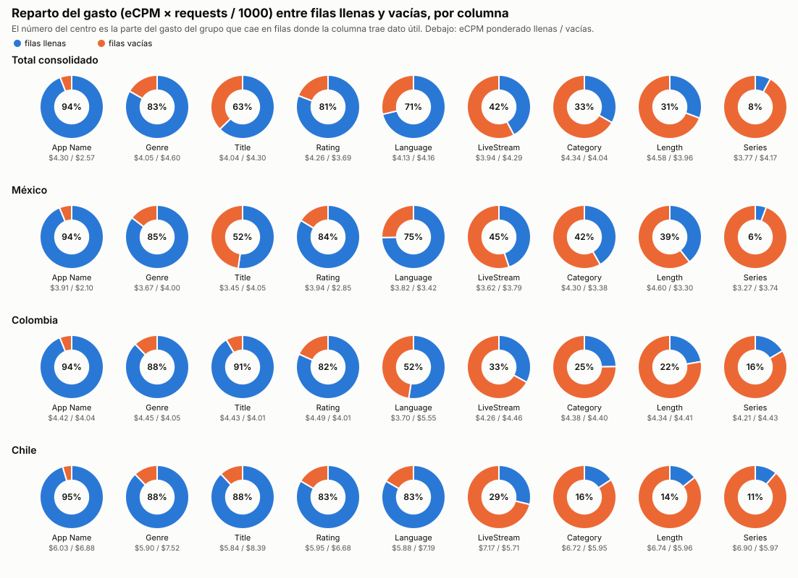
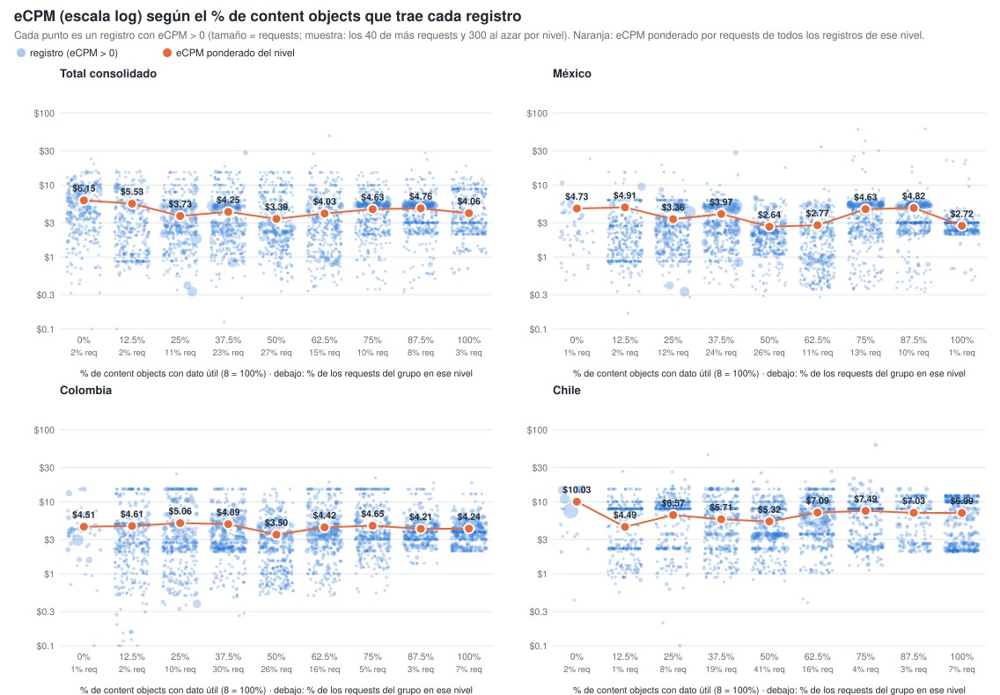
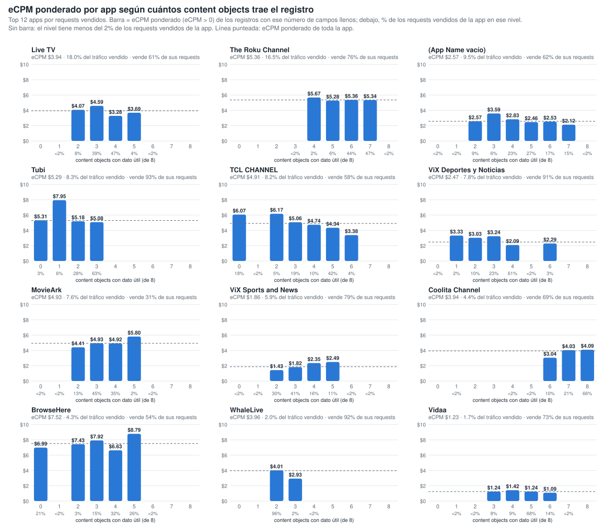
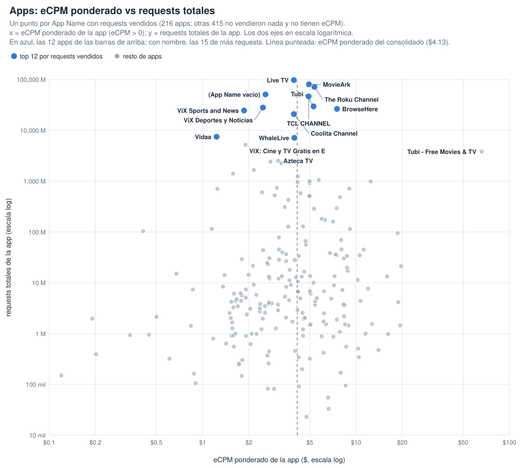
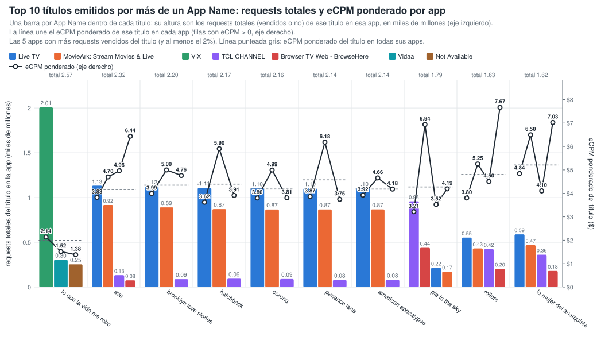
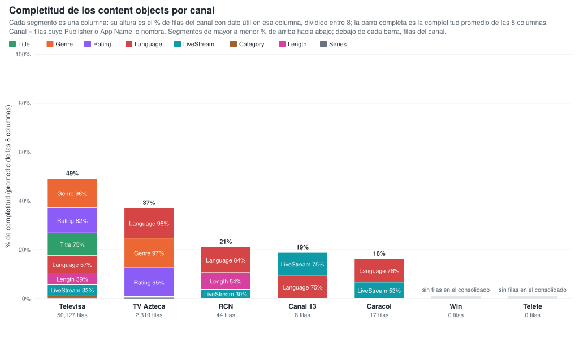
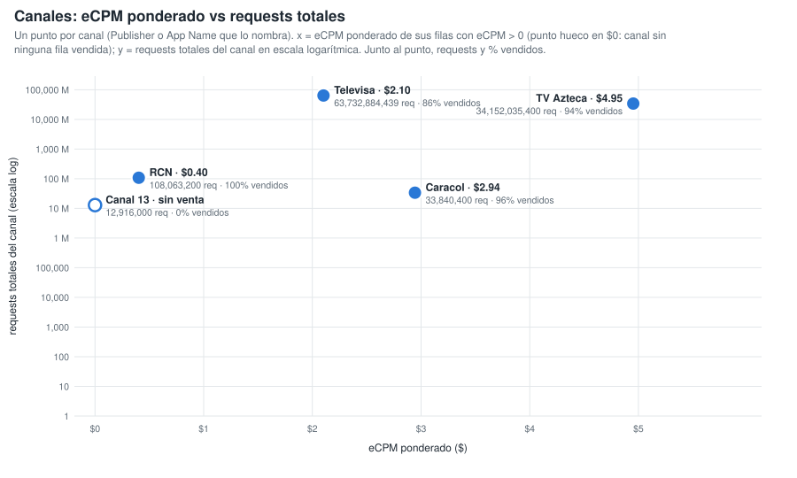
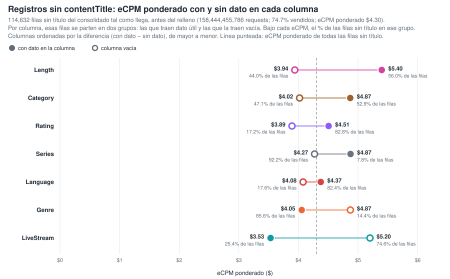
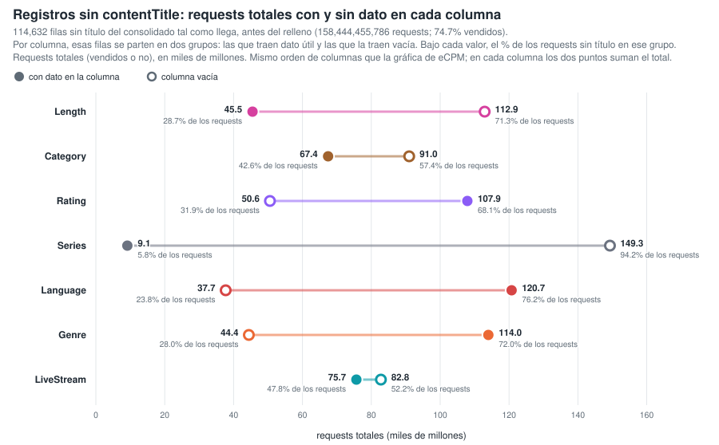
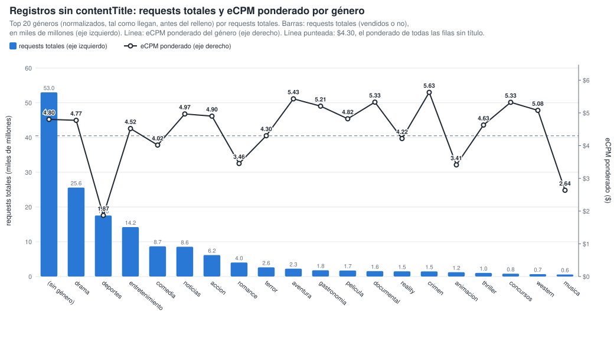

# Gráficos: eCPM de las filas llenas vs vacías (consolidado v10 a v26)

**Fuente:** `recursos/reporte-requests-ecpm-por-vacio-v26.json` (mismos datos de las tablas por país del detallado). Generado con `scripts/generar_graficos_ecpm_vacio.py` → `recursos/graficos-ecpm-vacio-r2.json`; tablas con `scripts/generar_reporte_graficos.py`.

*eCPM ponderado = Σ(eCPM × requests) / Σ requests, sin las filas con requests = 0 o eCPM = 0. Columnas: App Name y los 8 content objects con filas vacías; contentIsTitlePresent y Publisher vienen al 100% y no entran.*

## 1. Reparto del gasto (eCPM × requests / 1000) entre filas llenas y vacías

*% del gasto del grupo que cae en filas donde la columna trae dato útil. El gasto se calcula solo sobre filas con eCPM > 0.*

| Columna | Total consolidado | México | Colombia | Chile |
|---|---:|---:|---:|---:|
| App Name | 94.1% | 93.7% | 93.9% | 95.4% |
| contentGenre | 83.3% | 85.4% | 87.9% | 87.8% |
| contentTitle | 62.7% | 52.2% | 91.4% | 88.0% |
| contentRating | 80.8% | 83.8% | 81.7% | 83.5% |
| contentLanguage | 71.3% | 74.7% | 52.4% | 83.4% |
| contentIsLiveStream | 42.2% | 44.9% | 33.0% | 28.8% |
| contentCategory | 33.3% | 41.7% | 24.8% | 15.8% |
| contentLength | 30.8% | 39.4% | 22.3% | 14.4% |
| contentSeries | 7.9% | 5.7% | 16.4% | 11.3% |

## 2. % de columnas llenas de la fila vs eCPM (fila a fila)

Cada registro del consolidado se clasifica por el % de los 8 content objects que trae con dato útil (contentGenre, contentCategory, contentSeries, contentLength, contentLanguage, contentIsLiveStream, contentTitle, contentRating; contentIsTitlePresent no cuenta porque siempre viene). Cada punto es un registro con eCPM > 0, con el eCPM en escala logarítmica y el tamaño según sus requests (por nivel y panel se dibujan los 40 registros de más requests y 300 al azar). El punto naranja es el eCPM ponderado por requests de todos los registros del nivel. Generado con `scripts/generar_scatter_completitud_ecpm.py` → `recursos/graficos-ecpm-completitud-scatter.json`.

**Total consolidado** — 1,473,643 filas · 527,882,754,682 requests

| % de columnas llenas (de 8) | % filas | % requests | % requests vendidos (eCPM > 0) | eCPM pond. (>0) |
|---:|---:|---:|---:|---:|
| 0% (0) | 0.2% | 2.1% | 89.6% | $6.15 |
| 12.5% (1) | 1.9% | 1.8% | 55.0% | $5.53 |
| 25% (2) | 10.8% | 10.8% | 66.7% | $3.73 |
| 37.5% (3) | 23.3% | 23.1% | 67.8% | $4.25 |
| 50% (4) | 31.6% | 26.7% | 53.9% | $3.40 |
| 62.5% (5) | 21.5% | 15.0% | 47.8% | $4.03 |
| 75% (6) | 5.8% | 9.8% | 69.3% | $4.63 |
| 87.5% (7) | 2.6% | 7.8% | 81.7% | $4.76 |
| 100% (8) | 2.5% | 2.9% | 68.9% | $4.06 |

**México** — 443,729 filas · 328,451,835,721 requests

| % de columnas llenas (de 8) | % filas | % requests | % requests vendidos (eCPM > 0) | eCPM pond. (>0) |
|---:|---:|---:|---:|---:|
| 0% (0) | 0.1% | 0.7% | 84.5% | $4.73 |
| 12.5% (1) | 2.8% | 1.9% | 58.7% | $4.91 |
| 25% (2) | 13.6% | 12.2% | 77.3% | $3.36 |
| 37.5% (3) | 22.2% | 24.3% | 78.6% | $3.98 |
| 50% (4) | 29.5% | 26.4% | 58.6% | $2.64 |
| 62.5% (5) | 17.7% | 10.7% | 53.6% | $2.77 |
| 75% (6) | 8.3% | 12.6% | 74.6% | $4.63 |
| 87.5% (7) | 4.4% | 10.5% | 86.9% | $4.82 |
| 100% (8) | 1.5% | 0.8% | 71.4% | $2.72 |

**Colombia** — 154,752 filas · 38,733,556,932 requests

| % de columnas llenas (de 8) | % filas | % requests | % requests vendidos (eCPM > 0) | eCPM pond. (>0) |
|---:|---:|---:|---:|---:|
| 0% (0) | 0.2% | 1.2% | 85.1% | $4.51 |
| 12.5% (1) | 2.3% | 1.9% | 35.9% | $4.61 |
| 25% (2) | 13.6% | 10.2% | 43.3% | $5.06 |
| 37.5% (3) | 30.9% | 30.1% | 55.4% | $4.89 |
| 50% (4) | 24.4% | 25.5% | 47.6% | $3.50 |
| 62.5% (5) | 18.9% | 15.7% | 35.4% | $4.42 |
| 75% (6) | 5.2% | 4.8% | 43.2% | $4.65 |
| 87.5% (7) | 2.0% | 3.4% | 74.3% | $4.21 |
| 100% (8) | 2.5% | 7.2% | 82.8% | $4.24 |

**Chile** — 160,464 filas · 29,400,588,235 requests

| % de columnas llenas (de 8) | % filas | % requests | % requests vendidos (eCPM > 0) | eCPM pond. (>0) |
|---:|---:|---:|---:|---:|
| 0% (0) | 0.1% | 1.9% | 81.0% | $10.03 |
| 12.5% (1) | 1.7% | 0.9% | 20.5% | $4.49 |
| 25% (2) | 14.2% | 7.8% | 23.6% | $6.57 |
| 37.5% (3) | 28.3% | 18.8% | 24.7% | $5.71 |
| 50% (4) | 34.1% | 40.6% | 52.9% | $5.32 |
| 62.5% (5) | 14.5% | 16.0% | 36.9% | $7.09 |
| 75% (6) | 3.7% | 4.1% | 28.8% | $7.49 |
| 87.5% (7) | 1.4% | 3.2% | 27.8% | $7.03 |
| 100% (8) | 2.1% | 6.6% | 36.5% | $6.99 |

## 3. Por app: eCPM ponderado según cuántos content objects trae el registro

Top 12 apps por requests vendidos. Para cada app, barra = eCPM ponderado (eCPM > 0) de los registros con ese número de content objects con dato útil (de 8); debajo de cada barra, el % de los requests vendidos de la app en ese nivel. Los niveles con menos del 2 % de los requests vendidos de la app no se dibujan ni se tabulan. Generado con `scripts/generar_barras_app_completitud.py` → `recursos/graficos-app-completitud-barras.json`.

| App | eCPM pond. app | % tráfico vendido | 0 | 1 | 2 | 3 | 4 | 5 | 6 | 7 | 8 |
|---|---:|---:|---:|---:|---:|---:|---:|---:|---:|---:|---:|
| Live TV | $3.94 | 18.0% | — | — | $4.07 (8%) | $4.59 (39%) | $3.28 (47%) | $3.69 (4%) | — | — | — |
| The Roku Channel | $5.36 | 16.5% | — | — | — | — | $5.67 (2%) | $5.28 (6%) | $5.36 (44%) | $5.34 (47%) | — |
| Not Available | $2.57 | 9.5% | — | — | $2.57 (9%) | $3.59 (6%) | $2.83 (23%) | $2.46 (27%) | $2.53 (17%) | $2.12 (15%) | — |
| Tubi: Free Movies & Live TV | $5.29 | 8.3% | $5.31 (3%) | $7.95 (6%) | $5.18 (28%) | $5.08 (63%) | — | — | — | — | — |
| TCL CHANNEL | $4.91 | 8.2% | $6.07 (18%) | — | $6.17 (5%) | $5.06 (19%) | $4.74 (10%) | $4.34 (42%) | $3.38 (4%) | — | — |
| ViX: TV, Deportes y Noticias | $2.47 | 7.8% | — | $3.33 (2%) | $3.03 (10%) | $3.24 (23%) | $2.09 (61%) | — | $2.29 (3%) | — | — |
| MovieArk: Stream Movies & Live | $4.93 | 7.6% | — | — | $4.41 (13%) | $4.93 (45%) | $4.92 (35%) | $5.80 (2%) | — | — | — |
| ViX: TV, Sports and News | $1.86 | 5.9% | — | — | $1.43 (30%) | $1.82 (41%) | $2.35 (16%) | $2.49 (11%) | — | — | — |
| Coolita Channel | $3.94 | 4.4% | — | — | — | — | — | — | $3.04 (10%) | $4.03 (21%) | $4.09 (66%) |
| Browser TV Web - BrowseHere | $7.52 | 4.3% | $6.99 (21%) | — | $7.43 (3%) | $7.92 (15%) | $6.63 (32%) | $8.79 (26%) | — | — | — |
| WhaleLive | $3.96 | 2.0% | — | — | $4.01 (96%) | $2.93 (2%) | — | — | — | — | — |
| Vidaa | $1.23 | 1.7% | — | — | — | $1.24 (8%) | $1.42 (9%) | $1.24 (68%) | $1.09 (14%) | — | — |

*Entre paréntesis, el % de los requests vendidos de la app que cae en ese nivel de campos llenos.*

### 3.1 Apps: eCPM ponderado vs requests totales

Un punto por App Name con requests vendidos (216 apps; otras 415 no vendieron nada y no tienen eCPM). x = eCPM ponderado de la app (eCPM > 0); y = requests totales de la app; los dos ejes en escala logarítmica. Línea punteada: eCPM ponderado del consolidado ($4.13). Tabla: las 30 apps de más requests; todas están en `recursos/graficos-app-requests-ecpm.json`.

| App | Requests | Requests vendidos | % vendido | eCPM pond. |
|---|---:|---:|---:|---:|
| Live TV | 97,749,774,998 | 59,278,620,637 | 60.6% | $3.94 |
| MovieArk: Stream Movies & Live | 80,429,954,780 | 25,045,230,488 | 31.1% | $4.93 |
| The Roku Channel | 71,615,117,400 | 54,457,425,190 | 76.0% | $5.36 |
| Not Available | 50,976,950,328 | 31,383,482,141 | 61.6% | $2.57 |
| TCL CHANNEL | 46,625,913,901 | 27,063,782,562 | 58.0% | $4.91 |
| Tubi: Free Movies & Live TV | 29,679,706,500 | 27,477,754,296 | 92.6% | $5.29 |
| ViX: TV, Deportes y Noticias | 28,078,564,428 | 25,572,223,660 | 91.1% | $2.47 |
| Browser TV Web - BrowseHere | 26,429,215,023 | 14,193,245,440 | 53.7% | $7.52 |
| ViX: TV, Sports and News | 24,614,116,126 | 19,526,710,400 | 79.3% | $1.86 |
| Coolita Channel | 20,932,964,114 | 14,494,700,000 | 69.2% | $3.94 |
| Vidaa | 7,487,830,851 | 5,491,903,520 | 73.3% | $1.23 |
| WhaleLive | 7,135,862,720 | 6,567,724,960 | 92.0% | $3.96 |
| ViX: Cine y TV Gratis en Español | 5,215,991,217 | 4,305,961,200 | 82.6% | $1.91 |
| Tubi - Free Movies & TV | 3,813,222,818 | 56,320 | 0.0% | $65.89 |
| Azteca TV | 2,533,248,720 | 2,498,985,680 | 98.6% | $3.10 |
| TV Azteca En Vivo | 2,422,444,660 | 2,376,476,638 | 98.1% | $2.77 |
| SAMSUNG TV PLUS | 2,252,245,036 | 1,298,295,847 | 57.6% | $3.26 |
| VIX - Filmes e TV | 1,657,999,680 | 1,548,786,960 | 93.4% | $2.16 |
| ViX: Cine y TV en Español | 1,403,157,202 | 1,247,955,200 | 88.9% | $1.58 |
| Open Browser - TV Web Browser | 1,235,117,440 | 1,065,413,920 | 86.3% | $4.18 |
| Metax TV - Live TV & Movies | 1,056,807,520 | 740,324,320 | 70.1% | $5.71 |
| Ottera | 1,000,856,084 | 408,956,168 | 40.9% | $4.98 |
| PlutoTV: Stream Free Movies/TV | 990,326,480 | 397,556,080 | 40.1% | $12.46 |
| Plex: Find Movies & TV Shows | 951,670,267 | 121,035,717 | 12.7% | $4.16 |
| Plex - Free Movies & TV | 922,538,570 | 181,450,486 | 19.7% | $4.98 |
| FreeTV: Películas, Series y TV | 738,562,518 | 311,037,360 | 42.1% | $3.05 |
| Pluto TV: Watch Free Movies/TV | 712,843,761 | 137,558,400 | 19.3% | $9.05 |
| Univision App: Univision & Unimas Free | 709,555,852 | 686,980,068 | 96.8% | $1.25 |
| FreeTube- Search & Watch Free | 605,122,164 | 164,540,638 | 27.2% | $2.44 |
| Xiaomi TV+: Watch Live TV | 581,713,044 | 184,576,029 | 31.7% | $4.35 |

## 4. Títulos emitidos por más de un App Name

21,061 títulos reales, agrupados solo por App Name (sin pageURL). Generado con `scripts/generar_tabla_pageurl_titulos.py` → `recursos/titulos-appname.json`.

| App Name distintos por título | % de títulos | % de requests |
|---:|---:|---:|
| 1 | 52.1% | 8.0% |
| 2 | 25.1% | 9.3% |
| 3 | 9.0% | 12.2% |
| 4 | 3.7% | 2.2% |
| 5+ | 10.0% | 68.2% |

**Top 10 títulos (por requests) en dos o más App Name:** una barra por App Name dentro de cada título, con altura = requests totales (vendidos o no) de ese título en esa app, en miles de millones, en el eje izquierdo (las 5 apps con más requests vendidos del título, de mayor a menor requests). La línea une el eCPM ponderado (eCPM > 0) de ese título en cada app, en el eje derecho. Línea punteada = eCPM ponderado del título en todas sus apps; sobre cada grupo, los requests totales del título. Las variantes de ViX (ViX: TV, Deportes y Noticias; ViX: TV, Sports and News; ViX: Cine y TV…; VIX - Filmes e TV) cuentan como una sola app, ViX.

| Título | App Name | Requests | eCPM pond. | Reparto por app (% de requests vendidos, eCPM pond. de la app) |
|---|---:|---:|---:|---|
| lo que la vida me robo | 3 | 2,566,363,090 | $1.99 | ViX 78% ($2.14), Vidaa 11% ($1.52), Not Available 10% ($1.38) |
| eve | 10 | 2,322,472,966 | $4.17 | Live TV 62% ($3.83), MovieArk: Stream Movies & Live 28% ($4.70), TCL CHANNEL 6% ($4.96), Browser TV Web - BrowseHere 2% ($6.44), ViX 1% ($2.02) |
| brooklyn love stories | 9 | 2,199,764,749 | $4.35 | Live TV 67% ($3.99), MovieArk: Stream Movies & Live 29% ($5.00), TCL CHANNEL 2% ($4.76), Browser TV Web - BrowseHere 1% ($7.83), Not Available 0% ($3.85) |
| hatchback | 8 | 2,173,848,878 | $4.39 | Live TV 64% ($3.62), MovieArk: Stream Movies & Live 31% ($5.90), TCL CHANNEL 2% ($3.91), Browser TV Web - BrowseHere 1% ($7.29), Not Available 0% ($4.14) |
| corona | 9 | 2,159,238,140 | $4.18 | Live TV 67% ($3.80), MovieArk: Stream Movies & Live 29% ($4.99), TCL CHANNEL 3% ($3.81), Browser TV Web - BrowseHere 1% ($7.14), Not Available 0% ($3.91) |
| penance lane | 11 | 2,143,286,376 | $4.58 | Live TV 67% ($3.87), MovieArk: Stream Movies & Live 30% ($6.18), TCL CHANNEL 2% ($3.75), Browser TV Web - BrowseHere 1% ($6.61), Not Available 0% ($3.77) |
| american apocalypse | 9 | 2,142,577,315 | $4.18 | Live TV 67% ($3.92), MovieArk: Stream Movies & Live 29% ($4.66), TCL CHANNEL 2% ($4.18), Browser TV Web - BrowseHere 1% ($6.91), Not Available 1% ($5.06) |
| pie in the sky | 7 | 1,793,336,043 | $4.27 | TCL CHANNEL 58% ($3.21), Browser TV Web - BrowseHere 26% ($6.94), Live TV 11% ($3.52), MovieArk: Stream Movies & Live 4% ($4.19), Not Available 0% ($3.14) |
| rollers | 8 | 1,631,038,947 | $4.80 | Live TV 38% ($3.80), TCL CHANNEL 31% ($4.50), MovieArk: Stream Movies & Live 17% ($5.25), Browser TV Web - BrowseHere 14% ($7.67), Not Available 0% ($2.86) |
| la mujer del anarquista | 8 | 1,618,036,248 | $5.21 | Live TV 41% ($4.84), TCL CHANNEL 28% ($4.10), MovieArk: Stream Movies & Live 18% ($6.50), Browser TV Web - BrowseHere 12% ($7.03), Not Available 0% ($6.38) |

| Título | Requests del título | Requests por app (% de los requests del título) |
|---|---:|---|
| lo que la vida me robo | 2,566,363,090 | ViX 2,007,531,650 (78%), Vidaa 304,375,360 (12%), Not Available 254,456,080 (10%) |
| eve | 2,322,472,966 | Live TV 1,133,084,869 (49%), MovieArk: Stream Movies & Live 916,898,298 (39%), TCL CHANNEL 133,110,297 (6%), Browser TV Web - BrowseHere 75,639,622 (3%) |
| brooklyn love stories | 2,199,764,749 | Live TV 1,122,238,090 (51%), MovieArk: Stream Movies & Live 890,544,210 (40%), TCL CHANNEL 88,835,064 (4%) |
| hatchback | 2,173,848,878 | Live TV 1,107,964,852 (51%), MovieArk: Stream Movies & Live 871,742,040 (40%), TCL CHANNEL 94,018,122 (4%) |
| corona | 2,159,238,140 | Live TV 1,101,946,239 (51%), MovieArk: Stream Movies & Live 866,355,832 (40%), TCL CHANNEL 90,671,880 (4%) |
| penance lane | 2,143,286,376 | Live TV 1,102,045,133 (51%), MovieArk: Stream Movies & Live 866,885,720 (40%), TCL CHANNEL 79,813,302 (4%) |
| american apocalypse | 2,142,577,315 | Live TV 1,102,178,948 (51%), MovieArk: Stream Movies & Live 867,975,288 (41%), TCL CHANNEL 80,567,985 (4%) |
| pie in the sky | 1,793,336,043 | TCL CHANNEL 958,118,499 (53%), Browser TV Web - BrowseHere 439,262,030 (24%), Live TV 215,635,602 (12%), MovieArk: Stream Movies & Live 172,762,054 (10%) |
| rollers | 1,631,038,947 | Live TV 552,870,952 (34%), MovieArk: Stream Movies & Live 432,464,780 (27%), TCL CHANNEL 423,460,560 (26%), Browser TV Web - BrowseHere 203,841,123 (12%) |
| la mujer del anarquista | 1,618,036,248 | Live TV 589,410,207 (36%), MovieArk: Stream Movies & Live 468,711,266 (29%), TCL CHANNEL 362,398,434 (22%), Browser TV Web - BrowseHere 180,701,819 (11%) |

## 5. Completitud de los content objects por canal

Canal = filas cuyo Publisher o App Name lo nombra (Caracol via OB / ditu por Caracol, RCN via OB / Canal RCN, Canal 13 OB, Televisa Univision via … / ViX, TV Azteca - Springserve / Azteca TV). Cada segmento de la barra es una columna, con altura = % de filas del canal con dato útil en esa columna dividido entre 8, apilados de mayor % (arriba) a menor (abajo); la barra completa es la completitud promedio de las 8 columnas. La tabla va ordenada por completitud promedio. Generado con `scripts/generar_barras_canales_completitud.py` → `recursos/graficos-canales-completitud-barras.json`.

| Canal | Promedio | Filas | Requests | Title | Genre | Rating | Language | IsLiveStream | Category | Length | Series |
|---|---:|---:|---:|---:|---:|---:|---:|---:|---:|---:|---:|
| Televisa | 49.0% | 50,127 | 63,732,884,439 | 74.7% | 95.7% | 82.0% | 56.6% | 33.3% | 10.6% | 38.8% | 0.3% |
| TV Azteca | 37.0% | 2,319 | 34,152,035,400 | 2.6% | 96.8% | 94.8% | 98.5% | 0.8% | 0.6% | 0.6% | 0.9% |
| RCN | 21.0% | 44 | 108,063,200 | 0.0% | 0.0% | 0.0% | 84.1% | 29.5% | 0.0% | 54.5% | 0.0% |
| Canal 13 | 18.8% | 8 | 12,916,000 | 0.0% | 0.0% | 0.0% | 75.0% | 75.0% | 0.0% | 0.0% | 0.0% |
| Caracol | 16.2% | 17 | 33,840,400 | 0.0% | 0.0% | 0.0% | 76.5% | 52.9% | 0.0% | 0.0% | 0.0% |
| Win | — | 0 | 0 | — | — | — | — | — | — | — | — |
| Telefe | — | 0 | 0 | — | — | — | — | — | — | — | — |

*Win y Telefe no aparecen en el consolidado: ningún Publisher ni App Name los nombra.*

## 6. Canales: eCPM ponderado vs requests totales

Un punto por canal (mismos canales y misma definición de la sección 5). x = eCPM ponderado de sus filas con eCPM > 0; un canal con requests pero sin ninguna fila vendida va en $0 con un punto hueco; y = requests totales del canal en escala logarítmica. Junto al punto, requests totales y % de requests vendidos.

| Canal | Requests | Requests vendidos | % vendido | eCPM pond. |
|---|---:|---:|---:|---:|
| Televisa | 63,732,884,439 | 54,890,637,660 | 86.1% | $2.10 |
| TV Azteca | 34,152,035,400 | 32,143,292,454 | 94.1% | $4.95 |
| RCN | 108,063,200 | 107,918,080 | 99.9% | $0.40 |
| Caracol | 33,840,400 | 32,563,280 | 96.2% | $2.94 |
| Canal 13 | 12,916,000 | 0 | 0.0% | — (sin filas vendidas) |
| Win | 0 | 0 | — | — |
| Telefe | 0 | 0 | — | — |

## 7. Registros sin contentTitle: qué content objects se relacionan con el eCPM

114,632 filas sin título (158,444,455,786 requests; 74.7% vendidos; eCPM ponderado $4.30). Generado con `scripts/generar_graficos_sin_titulo.py` → `recursos/graficos-sin-titulo.json`.

### 7.1 eCPM ponderado con y sin dato en cada columna

Filas sin título del consolidado tal como llega, antes del relleno. Por columna se parten en dos grupos: las que traen dato útil (círculo lleno) y las que la traen vacía (círculo hueco); de cada grupo, su % de las filas sin título, su % de requests vendidos y su eCPM ponderado. Diferencia = eCPM con dato − eCPM sin dato.

| Columna | % filas con dato | % vendido con dato | eCPM pond. con dato | % filas sin dato | % vendido sin dato | eCPM pond. sin dato | Diferencia |
|---|---:|---:|---:|---:|---:|---:|---:|
| contentLength | 56.0% | 64.7% | $5.40 | 44.0% | 78.8% | $3.94 | +$1.46 |
| contentCategory | 52.9% | 58.3% | $4.87 | 47.1% | 86.9% | $4.02 | +$0.85 |
| contentRating | 82.8% | 73.2% | $4.51 | 17.2% | 78.0% | $3.89 | +$0.61 |
| contentSeries | 7.8% | 68.1% | $4.87 | 92.2% | 75.1% | $4.27 | +$0.60 |
| contentLanguage | 82.4% | 73.9% | $4.37 | 17.6% | 77.3% | $4.08 | +$0.30 |
| contentGenre | 85.6% | 72.4% | $4.05 | 14.4% | 80.6% | $4.87 | −$0.82 |
| contentIsLiveStream | 25.4% | 84.4% | $3.53 | 74.6% | 65.9% | $5.20 | −$1.67 |

### 7.2 Requests totales con y sin dato en cada columna

Las mismas filas sin título y los mismos dos grupos por columna que en 7.1 (mismo orden de columnas), con los requests totales (vendidos o no) de cada grupo en el eje x, en miles de millones. En cada columna los dos puntos suman el total de requests sin título (158,444,455,786).

| Columna | Requests con dato | % requests con dato | Requests sin dato | % requests sin dato |
|---|---:|---:|---:|---:|
| contentLength | 45,511,146,799 | 28.7% | 112,933,308,987 | 71.3% |
| contentCategory | 67,449,821,566 | 42.6% | 90,994,634,220 | 57.4% |
| contentRating | 107,888,388,380 | 68.1% | 50,556,067,406 | 31.9% |
| contentSeries | 9,134,536,511 | 5.8% | 149,309,919,275 | 94.2% |
| contentLanguage | 120,745,454,089 | 76.2% | 37,699,001,697 | 23.8% |
| contentGenre | 114,003,587,255 | 72.0% | 44,440,868,531 | 28.0% |
| contentIsLiveStream | 75,659,674,959 | 47.8% | 82,784,780,827 | 52.2% |

### 7.3 Requests totales y eCPM ponderado por género en las filas sin título

Género normalizado tal como llega. Explica el 17.1 % de la variación del eCPM ponderado solo y aporta 4.8 puntos más controlando por publisher × país (rating: 8.0 % y 5.3 puntos; livestream, length, categoría y series: 8.3 puntos o menos).

Top 20 géneros por requests totales. Barras = requests totales (vendidos o no) del género, en miles de millones (eje izquierdo), de mayor a menor; línea = eCPM ponderado del género (eje derecho). Línea punteada = eCPM ponderado de todas las filas sin título.

| Género | Filas | Requests | % vendido | % del tráfico vendido sin título | eCPM pond. |
|---|---:|---:|---:|---:|---:|
| (sin género) | 39,358 | 53,009,691,973 | 72.4% | 32.4% | $4.80 |
| drama | 10,698 | 25,611,881,523 | 68.3% | 14.8% | $4.77 |
| deportes | 4,913 | 17,557,564,258 | 91.6% | 13.6% | $1.87 |
| entretenimiento | 5,373 | 14,227,356,048 | 79.7% | 9.6% | $4.52 |
| comedia | 7,476 | 8,681,021,332 | 73.1% | 5.4% | $4.02 |
| noticias | 3,502 | 8,565,891,285 | 86.4% | 6.3% | $4.97 |
| accion | 6,116 | 6,188,434,918 | 75.6% | 4.0% | $4.90 |
| romance | 3,226 | 4,031,994,611 | 82.3% | 2.8% | $3.46 |
| terror | 2,953 | 2,644,223,615 | 72.8% | 1.6% | $4.30 |
| aventura | 1,655 | 2,259,765,122 | 65.2% | 1.2% | $5.43 |
| gastronomia | 725 | 1,795,971,282 | 66.2% | 1.0% | $5.21 |
| pelicula | 2,614 | 1,735,515,402 | 75.4% | 1.1% | $4.82 |
| documental | 3,316 | 1,557,839,874 | 62.2% | 0.8% | $5.33 |
| reality | 3,670 | 1,490,776,582 | 69.0% | 0.9% | $4.22 |
| crimen | 4,489 | 1,480,143,934 | 54.8% | 0.7% | $5.63 |
| animacion | 506 | 1,243,276,516 | 66.1% | 0.7% | $3.41 |
| thriller | 2,541 | 1,025,468,020 | 69.1% | 0.6% | $4.63 |
| concursos | 783 | 819,152,995 | 77.7% | 0.5% | $5.33 |
| western | 643 | 669,139,003 | 76.3% | 0.4% | $5.08 |
| musica | 649 | 588,109,360 | 63.2% | 0.3% | $2.64 |
